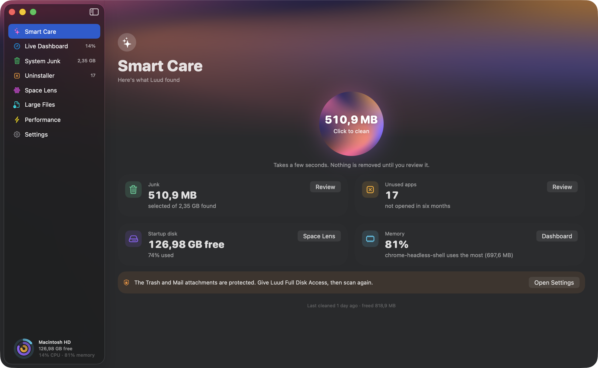
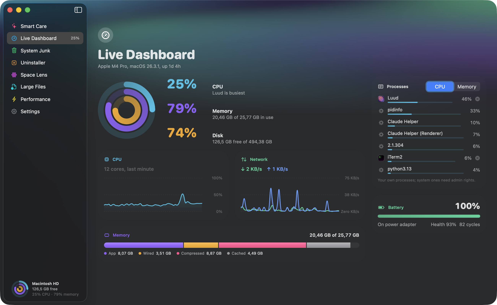
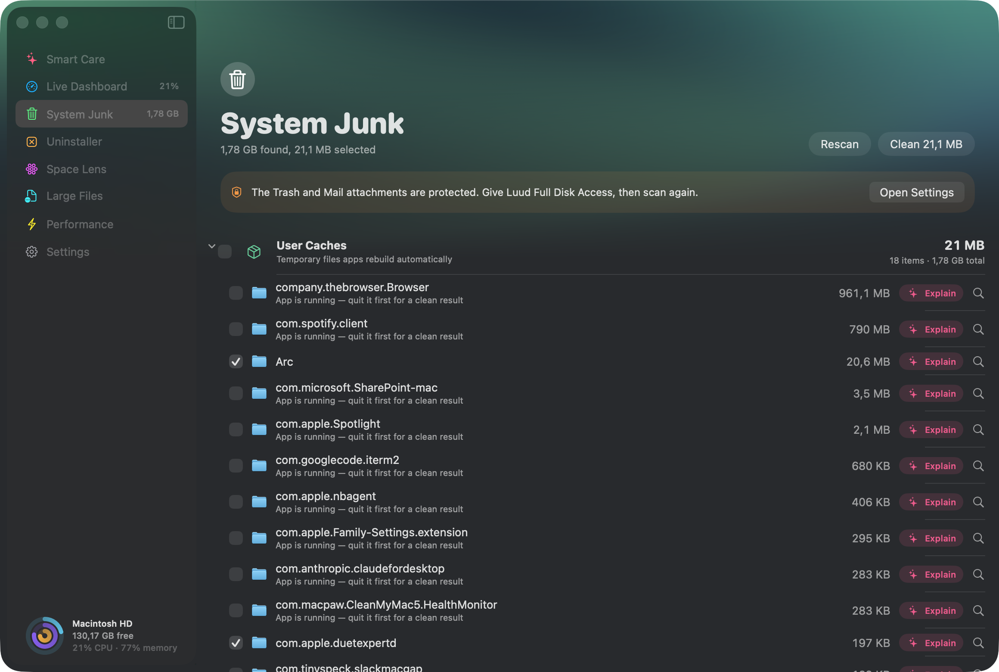
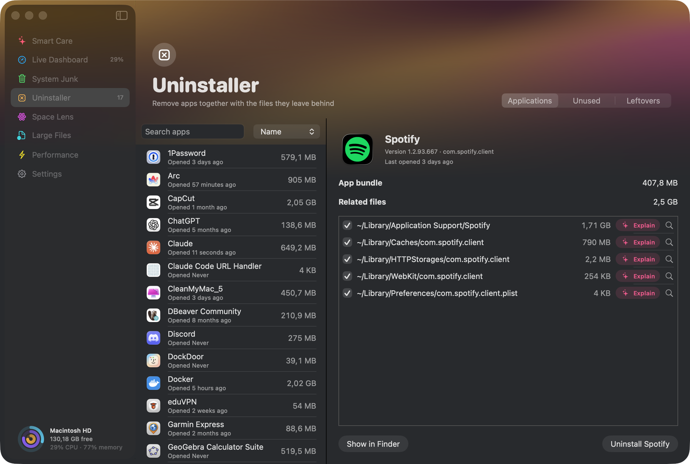
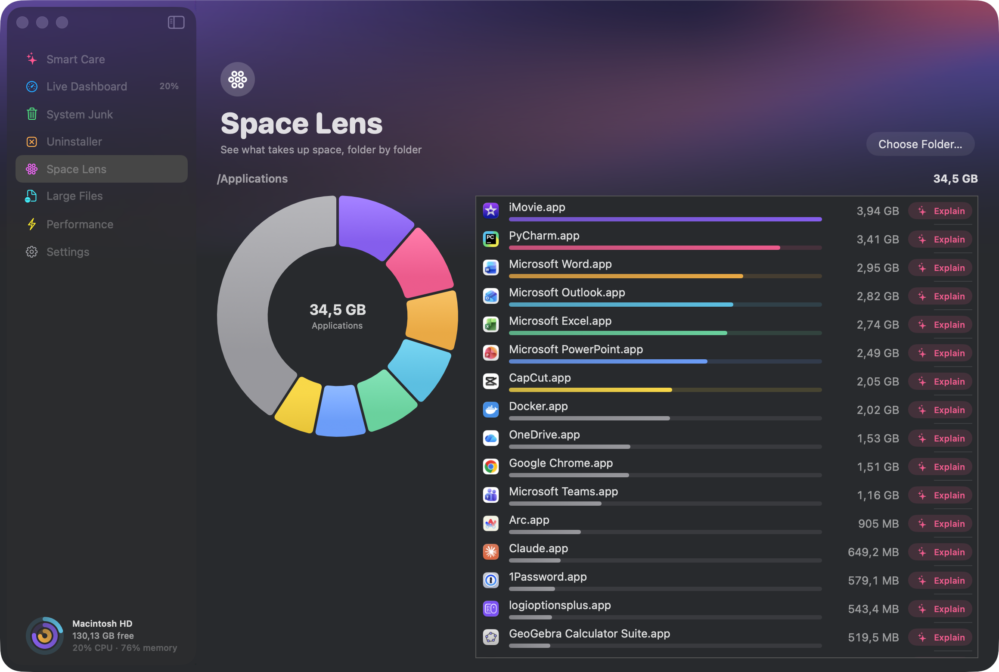
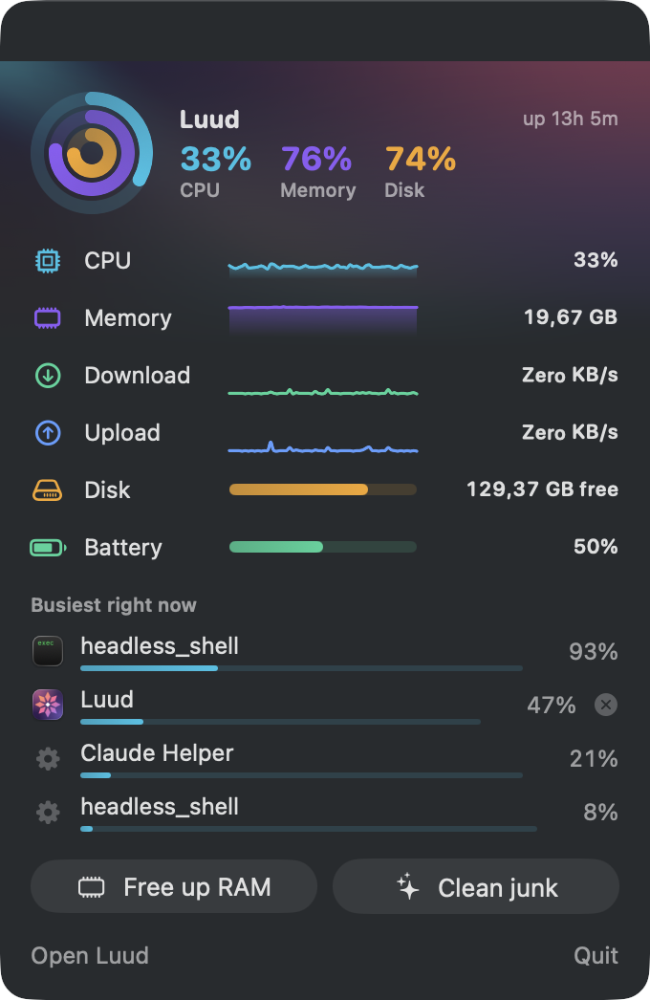

<div align="center">


# Luud

**A Mac cleaner and live system monitor, with on-device Apple Intelligence.**

*Luud* is Estonian for broom.


<a href="Design/demo.mp4"></a>

<sub>Click the animation for the full-quality video.</sub>

</div>

---

Luud keeps your Mac tidy and shows you what it's doing right now. It finds caches, logs, developer leftovers and forgotten installers, removes apps together with the files they scatter through your Library, maps what's filling your disk, and keeps CPU, memory, network, disk and battery one click away in the menu bar.

Nothing is removed until you've reviewed it. When you're not sure what a folder is, Luud asks Apple Intelligence, on your Mac, to explain it.

## Contents

- [Features](#features)
- [Getting started](#getting-started)
- [How cleaning works](#how-cleaning-works)
- [Apple Intelligence](#apple-intelligence)
- [Privacy](#privacy)
- [Scripts and tooling](#scripts-and-tooling)
- [Project structure](#project-structure)
- [Design](#design)
- [Limitations](#limitations)
- [Contributing](#contributing)
- [License](#license)

## Features

<table>
<tr>
<td width="50%"></td>
<td width="50%"></td>
</tr>
<tr>
<td><b>Smart Care</b><br>One scan for junk, apps you haven't opened in six months, disk space and memory.</td>
<td><b>Live Dashboard</b><br>CPU, memory breakdown, network, disk, battery health and the busiest processes, updated every second.</td>
</tr>
<tr>
<td></td>
<td></td>
</tr>
<tr>
<td><b>System Junk</b><br>Caches, logs, Xcode and developer caches, old installers, Mail attachments and the Trash, grouped and ticked for review. Each item has an <b>Explain</b> button.</td>
<td><b>Uninstaller</b><br>Removes an app with its related files. Also lists apps you don't use and leftovers from apps you've already deleted.</td>
</tr>
<tr>
<td></td>
<td align="center"></td>
</tr>
<tr>
<td><b>Space Lens</b><br>Every folder measured and sorted, with a ring chart. Click into anything big.</td>
<td><b>Menu bar</b><br>Live gauges, the busiest apps, and one-click Free up RAM.</td>
</tr>
</table>

Also included:

- **Large Files:** everything over 100 MB, 500 MB, 1 GB or 5 GB in your home folder, with when you last opened it.
- **Performance:** maintenance tasks (free up RAM, flush DNS, thin Time Machine snapshots, reindex Spotlight, rebuild Launch Services) and a list of background launch agents and daemons you can switch off and on again.
- **Alerts:** a notification when your startup disk drops below a threshold you choose.
- **Update notices:** Luud tells you when a new version is out (see [Updating](#updating)).
- **Open at login**, and a choice of what the menu bar shows (CPU and memory, CPU, memory, network speed or just the icon).

## Getting started

### Requirements

| | Minimum | For Apple Intelligence |
| --- | --- | --- |
| macOS | 15 Sequoia | 26 Tahoe, with Apple Intelligence turned on |
| Mac | Apple silicon or Intel (build on the Mac you'll run it on) | Apple silicon that supports Apple Intelligence |
| To build | Xcode Command Line Tools | Command Line Tools 26 or later (macOS 26 SDK) |

Full Xcode is not needed. Check what you have with `xcrun --show-sdk-version`. If it's older than 26, install the latest Command Line Tools from [developer.apple.com/download](https://developer.apple.com/download/all/) or with `softwareupdate`.

### Download

Get **Luud-<version>.dmg** from the [latest release](https://github.com/RobinJuul/luud/releases/latest), open it and drag Luud to Applications. Release builds run on both Apple silicon and Intel. They aren't notarized yet, so the first time you open Luud, allow it under System Settings → Privacy & Security → **Open Anyway**.

Or build it yourself:

### Build and run

```sh
git clone https://github.com/RobinJuul/luud.git
cd luud
./build.sh --install
```

That builds a release binary, wraps it in `Luud.app`, signs it for your Mac, copies it to `~/Applications` and opens it. Run `./build.sh` without `--install` to only build `build/Luud.app`.

### First run

1. Luud opens its window and adds a star with your CPU and memory to the menu bar. Closing the window keeps Luud in the menu bar; **Open Luud** brings it back.
2. Click **Scan** in Smart Care.
3. To include the Trash and Mail attachments, give Luud **Full Disk Access**: System Settings → Privacy & Security → Full Disk Access. Luud shows a button that takes you there.
4. Optional: turn on **Open at login** in Luud's Settings.
5. Optional: turn on Apple Intelligence for the Explain button. See [Turning on Apple Intelligence](#turning-on-apple-intelligence).

macOS may ask for access to Desktop, Documents or Downloads the first time you scan large files or use Space Lens. Some maintenance tasks ask for your administrator password through the standard macOS prompt.

### Updating

When a new version is released, Luud tells you:

- a notice at the top of the menu bar panel, with a **Download** button;
- one notification per new version;
- an **Update** badge on Settings, where Settings → Updates shows your version, when Luud last checked, and **Check Now**.

To update, click **Download**, open the new `.dmg` and drag Luud to Applications, replacing the old one. Your settings stay.

Releases from 0.1.3 on are all signed with the same certificate, so macOS recognises an update as the same app and keeps its permissions (Full Disk Access, Open at login). Coming from 0.1.2 or earlier, macOS asks once more: allow it under Privacy & Security → **Open Anyway** and give Full Disk Access again.

Prefer email? On GitHub, click **Watch → Custom → Releases** on this repository.

### Sharing a build

Release builds are signed with Luud's own certificate. Because it isn't from Apple, Gatekeeper blocks the first launch on any Mac until you allow it under System Settings → Privacy & Security → **Open Anyway**; after that, updates open normally. `build.sh` uses the certificate when it's in your keychain (named `Luud Code Signing`, or set `LUUD_SIGN_IDENTITY`) and signs ad hoc otherwise, which is fine for your own builds. A Developer ID with notarization would remove the Open Anyway step; it needs a paid Apple Developer account.

## How cleaning works

Luud looks in fixed, well-known places (see [`JunkRules.swift`](Sources/Luud/Cleanup/JunkRules.swift)), measures each item's real size on disk, and shows it for review. It never deletes on its own.

| Category | Where | When you clean |
| --- | --- | --- |
| User Caches | `~/Library/Caches/*` | Deleted. Apps rebuild them. |
| Logs & Crash Reports | `~/Library/Logs/*` | Deleted |
| Xcode Junk | DerivedData, device support files, simulator caches, archives | Deleted (archives start unticked) |
| Developer Caches | npm, Gradle, Cargo, Yarn, pnpm, conda, CocoaPods, Maven | Deleted (CocoaPods and Maven start unticked) |
| Installers in Downloads | `.dmg`, `.pkg`, `.iso`, `.xip` in `~/Downloads` | Moved to the Trash |
| Mail Attachments | Mail's local download folder | Moved to the Trash |
| Trash | `~/.Trash` | Deleted |

Safeguards:

- **Running apps:** caches of apps that are open right now are found but left unticked, with a note.
- **Protected caches:** iCloud, Keychain, Find My, HomeKit, Family and similar system caches are never listed, because clearing them can sign you out or break sync.
- **Your files go to the Trash:** anything you might want back (installers, attachments, uninstalled apps and their files, large files) is moved to the Trash, not deleted.
- **Uninstalling** quits the app first and only removes the related files you leave ticked. Leftovers of already-deleted apps are matched by bundle identifier and start unticked.
- **Admin tasks** run only after the standard macOS password prompt, and only for the maintenance tasks and system daemons you choose.

## Apple Intelligence

Every item in System Junk, Space Lens, Large Files and the Uninstaller has an **✨ Explain** button. It answers two questions in plain language: *what is this?* and *what happens if I delete it?*, and gives a verdict: **Safe to delete**, **Check first** or **Keep**.

It uses Apple's [Foundation Models](https://developer.apple.com/documentation/foundationmodels) framework, which runs Apple's language model on your Mac. Nothing is sent to a server.

### How an answer is made

```
 file or folder
      │
      ▼
 1. Luud gathers facts locally ──► path, size, dates, kind, top-level names inside,
      │                            owning app and whether it's installed or running
      ▼
 2. Luud's rules read the location ──► "a cache folder; apps rebuild it",
      │                                "data an app shares with its extensions", …
      ▼
 3. Rules decide the verdict when the location settles it
      │     caches, logs, build output  → Safe to delete
      │     data of an installed app    → Check first
      │     files of an uninstalled app → Safe to delete
      │     Documents, Desktop          → Keep
      ▼
 4. The on-device model writes the explanation,
    and picks the verdict only where the rules have no answer
```

The model's answer is structured, not free text: Luud passes a schema (`whatItIs`, `ifDeleted`, and `verdict` when needed) and the model fills it in. Sampling is greedy, so the same item always gets the same answer.

### Why the rules decide, not the model

The on-device model is small, and on its own it wasn't reliable enough to trust with deletion advice. In testing it:

- marked almost everything "Check first", including caches that are plainly safe to remove;
- claimed deleting Spotify's cache would erase Spotify's settings, which isn't true;
- said a folder belonged to an installed app when the facts said the app was gone.

So the facts Luud knows for certain (where a file lives, whether its app is installed) decide the verdict, and the model does what it's good at: explaining it in plain words. With that split, every test item the rules covered got the right verdict, and the model's calls on unfamiliar folders were reasonable but sometimes vague. You can see the logic in [`ItemExplainer.swift`](Sources/Luud/AI/ItemExplainer.swift).

### Turning on Apple Intelligence

The Explain button needs Apple Intelligence, which comes with macOS but is off until you turn it on.

1. **Check your Mac.** You need a Mac with Apple silicon (M1 or later, including the M1 MacBook Air) running macOS 26 or later.
2. **Open the settings.** Choose Apple menu → System Settings → **Apple Intelligence & Siri**. Luud can take you there: Settings → Apple Intelligence → **Open Settings**, or **Open Apple Intelligence Settings** in the Explain popover.
3. **Turn on Apple Intelligence.** macOS then downloads the model. That needs several gigabytes of free space and can take a while; the settings page shows the progress.
4. **If the switch is missing or greyed out,** make your Mac's language and Siri's language the same supported language, for example English. Set them in System Settings → General → Language & Region and under Apple Intelligence & Siri.
5. **Back in Luud,** click ✨ Explain on any item. Settings → Apple Intelligence shows *Ready on this Mac* once it works.

On a Mac without Apple Intelligence, everything else in Luud works the same; only the Explain button can't answer.

### Limits

- The Explain button never ticks or unticks anything. What gets removed is decided by Luud's rules and by you.
- Answers for unfamiliar folders can be vague, and the popover says the model can be wrong.
- If Apple Intelligence is off or still downloading, the popover says so and tells you where to turn it on.
- Builds made with an SDK older than macOS 26 leave the Explain button out entirely; everything else works.

## Privacy

- **One network request, once a day.** Luud asks GitHub for the latest release to tell you about updates. The request carries nothing about you or your Mac, and you can turn it off in Settings → Updates. There are no analytics and no telemetry.
- **On-device AI.** Explanations come from the model on your Mac, and the model only sees the short fact list above, never file contents.
- **Local settings.** Your preferences live in macOS's normal app preferences, and nothing else is stored.

## Scripts and tooling

| Path | What it does |
| --- | --- |
| [`build.sh`](build.sh) | `swift build -c release`, assembles `Luud.app` (binary, `Info.plist`, icon), signs it ad hoc. `--install` copies it to `~/Applications` and launches it. `--universal` builds for Apple silicon and Intel and joins them with `lipo`. |
| [`Support/make-icon.swift`](Support/make-icon.swift) | Draws the app icon from vectors at every size (16 px to 1024 px) into an `.iconset` for `iconutil`. Run by `build.sh` when `build/AppIcon.icns` is missing. |
| [`Scripts/screenshots.sh`](Scripts/screenshots.sh) | Regenerates the README screenshots: launches Luud in staged states and captures its window with `screencapture`. `./Scripts/screenshots.sh menu-bar` captures just one. Needs Screen Recording permission for your terminal. |
| [`Scripts/window-id.swift`](Scripts/window-id.swift) | Helper for the screenshot script: finds Luud's window number. |
| [`Scripts/package.sh`](Scripts/package.sh) | Builds a universal `Luud.app` and packages it into `dist/`: a DMG, a zip and `SHA256SUMS`. |
| [`.github/workflows/release.yml`](.github/workflows/release.yml) | Runs `package.sh` on a macOS 26 runner. A `v*` tag publishes a GitHub Release; a push to a `release/*` branch only builds, as a workflow artifact. |
| [`Film/`](Film) | The demo video. See below. |
| [`Design/render-concepts.swift`](Design/render-concepts.swift) | Renders the logo concepts explored before the final icon. |

### Making a release

1. Set `CFBundleShortVersionString` in [`Support/Info.plist`](Support/Info.plist) to the new version and raise `CFBundleVersion` by one.
2. Add a section for it to [`CHANGELOG.md`](CHANGELOG.md). Its text becomes the release notes.
3. Optional: push to a `release/<version>` branch and try the package from the workflow run's artifacts.
4. Tag the commit on `main` and push the tag:

```sh
git tag v0.1.1
git push origin v0.1.1
```

The workflow checks that the tag matches `Info.plist` and that the changelog has an entry, signs the app with the certificate from the `LUUD_SIGNING_P12` and `LUUD_SIGNING_PASSWORD` repository secrets (it won't publish an unsigned release), then publishes the release. Installed copies of Luud see it within a day. To package locally instead, run `./Scripts/package.sh`.

### Launch options

Luud reads a few optional arguments at launch. The screenshot script uses them, and they're handy for development. They're stored nowhere and change nothing when absent.

```sh
open ~/Applications/Luud.app --args -LuudSection dashboard
```

| Argument | Effect |
| --- | --- |
| `-LuudSection <name>` | Opens on a screen: `smartCare`, `dashboard`, `cleanup`, `uninstaller`, `spaceLens`, `largeFiles`, `performance`, `settings` |
| `-LuudAutoScan YES` | Starts the scan for Smart Care or System Junk right away |
| `-LuudSpaceLensRoot <path>` | Folder Space Lens maps on launch |
| `-LuudSelectApp <bundle id>` | App the Uninstaller selects once apps are listed |
| `-LuudMenuPreview YES` | Shows the menu bar panel in a regular window (the real one only opens on click) |
| `-LuudPretendUpdate <version>` | Acts as if that version were the latest release, without asking GitHub |

### The demo video

The film at the top isn't a screen recording. It's a web page, [`Film/film.html`](Film/film.html), that rebuilds Luud's screens in HTML with made-up sample data, animated with one [GSAP](https://gsap.com) timeline. [`Film/render.mjs`](Film/render.mjs) opens it in headless Chrome with [Playwright](https://playwright.dev), moves the timeline forward one frame at a time, takes a screenshot of each frame at 2× resolution, and pipes them into ffmpeg. Because time only moves when the script says so, every render is identical, however fast the machine.

```sh
cd Film
npm install
npx playwright install chromium
open film.html                         # preview it playing in a browser
node render.mjs --stills 3,18,28.8     # check a few frames first → out/still-*.png
node render.mjs                        # full film → out/luud-demo.mp4
```

Each frame averages two screenshots taken half a frame apart (`BLUR_SAMPLES`, default 2) for a touch of motion blur. To make the README animation from the film:

```sh
ffmpeg -i out/luud-demo.mp4 -vf "fps=15,scale=860:-1:flags=lanczos,split[a][b];[a]palettegen=max_colors=192[p];[b][p]paletteuse=dither=sierra2_4a" ../Design/demo.gif
```

The page uses SF Pro Rounded from `/System/Library/Fonts`, so render it on a Mac.

## Project structure

```
Sources/Luud/
├── App/            LuudApp (scenes, menu bar, launch handling), LaunchOptions
├── Stats/          Samplers (CPU, memory, network, processes, battery) and SystemStats, sampled once a second
├── Cleanup/        JunkRules (where to look and how to dispose) and CleanupModel (scan, clean)
├── Uninstaller/    AppCatalog (installed apps, related files, orphans) and UninstallerModel
├── SpaceLens/      Space Lens folder sizes and the Large Files finder
├── Performance/    Maintenance tasks, launch agents and daemons
├── AI/             ItemExplainer (facts, rules, Foundation Models) and the Explain button
├── Util/           File sizing, shell and admin commands, formatting
└── Views/          SwiftUI screens, Theme (colours, corners, motion), Glyph (menu bar star)
Support/            Info.plist and the icon renderer
Scripts/            Screenshot automation and release packaging
Film/               The demo video page and renderer
Design/             Icon, screenshots, demo video and logo concepts
```

How the pieces fit:

- **System stats** come straight from macOS: Mach host statistics for CPU and memory, `sysctl` routing tables for network counters, `libproc` for processes, IOKit for the battery. One timer samples everything once a second and SwiftUI redraws once per tick.
- **Scans** run off the main thread in task groups, one per category, and stream results into the interface as each finishes.
- **Removal** uses `FileManager` for deletions and `NSWorkspace.recycle` for anything that goes to the Trash. Admin-only actions go through `osascript … with administrator privileges`, which shows the standard password prompt.

Built with Swift Package Manager, no third-party dependencies.

## Design

The icon is a **kaheksakand**, the eight-pointed star of Estonian folk patterns, knitted into mittens and woven into belts and traditionally a sign of protection and luck. Here it guards your Mac. Each petal is a diamond around a bright centre, and the colours run from amber through pink to violet, the same colours the app uses for its brand.

Inside the app, each metric keeps one colour everywhere: CPU cyan, memory violet, disk amber, network mint. Corner radii follow Apple's concentricity rule (a nested shape's radius is its container's radius minus the padding between them), and live values animate briefly enough that the display can rest between updates. See [`Theme.swift`](Sources/Luud/Views/Theme.swift).

## Limitations

- **Not notarized** yet, so the first launch needs *Open Anyway*.
- **Updates are a download.** Luud tells you about a new version, but you install it yourself; one-click updates would come with notarization.
- **Process lists show your own processes.** System processes owned by root can't be inspected without admin rights.
- **No malware scanning.** macOS's built-in XProtect covers known malware.
- **No desktop widget yet.** WidgetKit extensions need full Xcode to build.

## Contributing

Found a bug or have an idea? [Open an issue](https://github.com/RobinJuul/luud/issues/new). Pull requests aren't accepted from outside contributors, but you're welcome to fork Luud and change it however you like under the [MIT license](LICENSE).

If you add a junk location in your fork, put it in `JunkRules.swift` with the right disposal: **delete** only for things apps rebuild by themselves, **Trash** for anything a person might want back.

## License

[MIT](LICENSE) © 2026 Robin Juul
